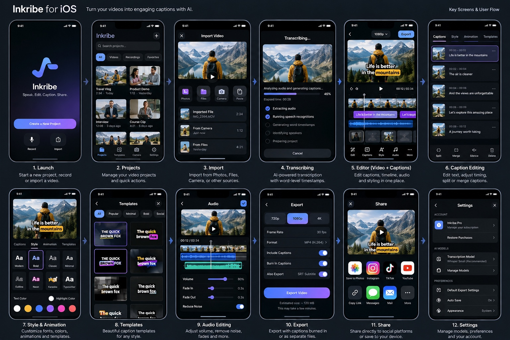

> Historical snapshot before the 2026-10-24 consolidation. Current contracts are in [README](../../README.md); instructions and status here are superseded.

# Inkribe iOS v1 design

## Current work — issue #38 production passes 1–5 (2026-10-24)

The user authorized pass 5 in existing [PR #39](https://github.com/hoangbkit/Inkribe/pull/39)
(`feat/ios-project-packages` → develop), retaining passes 1–4. All five source passes
are integrated: packages, processing, home/native flow, scrolling editor and now
versioned caption values/catalog, ten curated looks, renderer/layout/motion extensions,
independent resets, compatibility/access and production metadata source review.
Read [phase](../../phases/CAPTION_PRODUCTION.md), [handoff](../../handoffs/CAPTION_PRODUCTION.md)
and [readiness record](../../PRODUCTION_READINESS.md). Canonical schema 8 reads 1–7;
existing queue/checkpoint/request wrappers and working transcription are retained.
Shared style/catalog/motion values are consumed by iOS without changing Mac APIs.

Source/call-site/diff/whitespace and publication review only. Shared regression
specifications are authored, unexecuted. No builds/typechecks/tests/fixtures, CI,
generation, model downloads, native inference/exports, UI/device/accessibility or
deployment. Production verification and owner inputs remain pending, including the
placeholder privacy URL, live commerce, licensed footage/device/preview-export
acceptance and archive privacy report. Leave PR open without auto-merge. Earlier
pass-specific holds below are historical; source integration is not release readiness.

## Caption collection — issue #38 pass 5

Ten source-integrated looks cover Essential, Creator, Podcast, Cinematic, Education
and Editorial. Basic/four original looks retain historical definitions; five added
looks use different font/weight, line treatment, emphasis, background/shadow and
motion combinations. The [phase](../../phases/CAPTION_PRODUCTION.md) contains the design
matrix; no device-rendered visual approval is claimed. Browser categories, saved
version, Customized/custom placement, current locks and named resets are explicit.

Typography/colors/backdrop/layout/placement/motion controls remain focused and
preview-backed. Apply retains user placement; recommended placement is a separate
undoable action. Fitting and wrapping never rewrite canonical captions or timing.
Bounded real-footage comparisons use the same resolved style, font/layout and
motion rules as preview/export. OS fallback and actual SE2/large-iPhone/script/
output acceptance remain pending, recorded in the final handoff/readiness report.

## Scrolling editor — issue #38 pass 4

Actual preview → transport/timeline → horizontal Captions/Style/Timing/Media pills
→ active workspace form one main scroll. Expansion only grows the preview. Caption
correction remains the primary transcript interaction; word/phrase timing, split,
merge and gaps/retry stay inline. Follow playback is explicit/off initially and
never changes selected correction/focus. Per-tool anchors and accepted field drafts
survive presentation recreation in the app-owned session.

Style leads with actual-content comparisons of Basic and the four current looks.
A frozen real frame is shared; silence/gaps/hidden captions stay empty. Selected,
Customized, custom placement, Pro locks and named resets are explicit. Text/Colors/
Backdrop/Position/Motion details include real preview/playback in the same sheet
scroll. Theme surfaces/borders/accent and semantic typography carry surrounding UI;
caption artwork still comes from the existing renderer. Keyboard/large-text/VoiceOver
and frame/render performance need device validation; see EDITOR_EXPERIENCE handoff.

## Home and native flow — issue #38 pass 3

Home follows the inspected AppShot/AppReel hierarchy: a large rounded creation
hero, benefit headline/supporting copy and primary New Project CTA, then scrolling
recovery/queue activity, project header/filters and compact thumbnail rows. Hero
and filter strip hide during search; sort/results and a clear-filter action remain.
Empty home uses one creation pitch. Rows show actual title/type/duration/update/
caption or recovery state, with a separate sibling actions menu. Semantic text and
wrapping grow on small iPhones/large text; decorative thumbnails/badges yield space
at accessibility sizes. Theme tokens supply surfaces/text/borders/accent, never
hardcoded white-on-dark artwork. No sticky/floating activity or creation component.

Native Back and edge-swipe replace the custom save-blocking Back. Expanded-preview
collapse has a separate trailing control. The existing AppFoundation background
extends under the native bar; its flat solid-color toolbar override is removed.
Pending/failed changes stay available via app-owned sessions and a Home recovery
card rather than trapping navigation. Confirmed discard explains that it removes
the unsaved editor/recovery draft, not saved projects or exports. Native cancelled-
swipe focus/selection/playback/scroll behavior still needs device validation.

New Project preserves Photos/Files/direct URL, separate/combined imports and canvas
review. Partial/cancelled imports retain committed project IDs, show remaining files
for retry, and navigate only after explicit review or full success and dismissal.
Photos preparation is cancellable and late transfers cannot affect a new selection.
Settings/Storage have one sheet route each and surrounding forms share theme tokens.
AppFoundation paywall/celebration/themes/restore/devtools and free/Pro policy remain.
Full editor scrolling/control layout and style expansion are passes 4–5.

## Queue and delivery — issue #38 pass 2

Custom AppFoundation-themed List with scrolling status/control card, All/Pending/
Processing/Done/Failed scopes and counts, type/search/display-sort filters, native
rows and detail navigation by compound type/job ID. Capacity waiters are Pending,
not fake progress. Rows show title/thumbnail/type/stage/time/error; details show
captured model/language or frozen export profile/revision and project navigation.
Actions resolve live records, confirm cancellation/removal/file deletion and report
failures inline. Bulk retry uses application authorization, not generic retryAll.

Home toolbar, scrolling activity summary, editor actions, transcription status,
export selection and Storage link to Queue. No sticky/floating activity panel.
Export creation navigates directly to its exact job. Per-output Save to Photos,
Files and Share capture one immutable URL/lease through native completion/cancel.
Removing a record, deleting export files and moving a project to Trash have
separate wording/effects. Empty/filter-empty, user/system pause, persistence failure,
partial captions, unavailable model/project and missing output are explicit.
Native navigation/home hero/editor scrolling redesigns remain passes 3–4.

## Approved editor implementation — issue #36 / PR #37 (2026-10-23)

The user approved implementation of the editor visualization. This supersedes the earlier panel hierarchy and complete-only caption policy.

- Compact footage with actual rendered captions, native project/save navigation and Export; play/scrub/clocks/undo and a slim caption/gap lane.
- The readable transcript stays visible. Selected rows edit the entire caption directly; timestamp, Timing and Split/Words remain beside it. Word controls retain native timing rather than synthesizing new aligned words.
- Inline missing ranges have Retry. Accepted captions stay editable and exportable while other ranges are unresolved; compact progress/status never replaces the transcript.
- Bottom Captions / Style / Timing; Style includes existing templates, Words & timing retains advanced correction/split/merge, Media stays in actions. Preserve existing tools and Pro gates.
- First available captions and selected rows reveal footage slightly inside their real interval; playback uses actual timing, with gaps remaining empty.
- Keyboard/short-workspace strip, native themes, accessibility and one shared renderer/player remain. No fake captions/media. Source integration only; native layout and behavior require user validation.

> Current repair (2026-10-23): all four requested passes are source-implemented in open PR #35 targeting develop; no auto-merge. Read [handoffs/TRANSCRIPTION_WORKSPACE.md](../../handoffs/TRANSCRIPTION_WORKSPACE.md) and [HANDOFF.md](../../HANDOFF.md) for current behavior and user validation. Builds/runtime/device checks are unrun. Earlier phase/Pro branch holds below are historical; no next phase or merge is authorized.

> Current amendment (2026-10-22): PR #30 is squash merged as eb89f0f. The user has now authorized Pro locking and AF themes; [phases/PRO.md](../../phases/PRO.md) and [handoffs/PRO.md](../../handoffs/PRO.md) supersede historical Pro deferral, 28/29 accounting and PR #30 review holds below. The new phase stays open on feat/ios-pro-access-themes → develop. All 29 V1 items are source-integrated; compilation/runtime/user validation is unrun.

Reference supplies dark surfaces, restrained purple/blue accents, strong footage previews, thumbnails and caption styling. It does not authorize every pictured control; PLAN/FEATURES overrides it. Preserve Mac branding.

| Surface | V1 behavior | Phase |
|---|---|---|
| Projects | Normal launch, empty-state Add, thumbnails, rename/duplicate/delete | P1 |
| Import | Photos/Files video/audio; loading/cancel/errors | P1 |
| Transcribing | Local language choice, real stages/progress/cancel/retry | P2 |
| Editor | Compact footage above caption list, simple timeline, timing/text edits, undo | P3 |
| Styles/templates | Fonts/size/color/outline/background/position and curated four effects | P4 |
| Export | MP4 720p/1080p or SRT, Save/Share | P5 |
| Media tools | Trim, crop/ratio, original-audio volume | P6 |
| Settings/Pro | Necessary model/storage controls and AppFoundation paywall/restore | Owning phase |

One coherent tool hierarchy. Preserve footage context during typing and selection/playback across panels. Readable controls fit small supported iPhones; scroll focused panels instead of tiny stacked tracks. Output-coordinate placement and shared typography/motion in preview/export. Respect accessibility and surrounding UI text-size/reduced-motion needs.

No camera, cloud, translation, team, publishing or advanced editor screens. No iPad-specific workspace/external-display feature work; existing target settings are not changed here. New UI needs a short plan/approval. Routine P1 already approved. This docs change removes no existing UI.

## P3 implemented layout

The user requested P3 after P2 merge; the short plan stated compact preview above transport, simple timeline and correction/list panels. Footage remains visible during typing (reduced height), and focused controls scroll. Caption text is corrected per timed unit with optional phrase replacement; selecting the word exposes its timing and split boundary. Cue/word numeric timing lives in disclosure panels. Undo/redo and project actions are in the toolbar; project title/original-media/relink controls remain under a disclosure. Playback highlights the active list cue; selecting a cue pauses/seeks and returns to correction controls. No camera/audio suite or other reference-only controls added. UI/keyboard/accessibility behavior still needs user validation.

## P4 implemented layout

The user requested this phase after P3 merge. The stated plan adds Captions/Style/Templates tool tabs below the stable footage/transport/timeline. Style scrolls fonts, size, text color, one effect picker and highlight color, with outline/background and position disclosures. Top/Center/Bottom actions complement horizontal/vertical placement sliders. Templates are four compact choices with the current look marked; applying one updates current-footage preview and preserves chosen placement. No template auto-plays media. Styling/reset/template changes are undoable and saved automatically.

Font labels are Modern (Avenir Next Demi Bold), Bold (Helvetica Neue Bold), Serif (Georgia Bold) and Mono (Menlo Bold), with explicit installed-script/emoji/system fallback. Presets are Spotlight (yellow active-word background), Karaoke (mint progressive fill), Pop (pink word-triggered pulse) and Soft Fade (serif fade). All properties remain editable. No custom font import, brand kit, marketplace, AI styling or extra effect catalog. Preview uses the same Core Text layout/effect renderer as the bitmap/composition adapter; surrounding UI respects Dynamic Type/VoiceOver/Reduce Motion. Device UI/font/shaping validation is still pending.

## P5 implemented layout

The current P5 request and stated short plan cover an Export sheet from the editor and a Current export toolbar shortcut in Projects. Choose captioned MP4 or edited SRT; MP4 offers 720p/1080p with actual dimensions displayed. Show progress, cancel, retry, clear errors and completed-file Save to Photos/Files/share actions. Photos is MP4-only; SRT uses Files/share. A current-job shortcut keeps delivery/discard accessible after project deletion. Export work can continue with the sheet closed while the app remains active. Starting another export explicitly replaces the one local artifact; the text explains saving it first. Discard affects only export files/pins, not the project. Storage shows current-export usage.

Native document picker and share sheet retain file access until their callbacks/dismissal; Photos retains it through authorization/write completion. Permission denial offers Files rather than prompting for library read access. The user selected Defer Pro, so no paywall, invented limits or pricing are added. UI/VoiceOver/small-screen/provider behavior remains unverified; no UI tests executed.

## P6 implemented layout

The user requested P6 after merging P5. The stated Media panel adds whole-project trim start/end fields with Apply/Reset, exact retained output length, Original video/9:16/1:1/16:9 aspect choices, Fit/Fill crop, zoom/horizontal/vertical position, crop reset, original-audio volume and volume reset. Media is available before transcription; caption-only tools appear after recognition. Shared focus reduces the footage preview and hides the overview while entering trim numbers, using the existing keyboard Done action. No new timeline tracks, gestures/keyframes or production suite.

Trim fields use original project seconds; transport/list/export start at zero for the retained range. Caption timing correction disclosures explicitly retain original project seconds after trim so adjusting a boundary unit does not silently delete its hidden source-side timing. Text/list rows show only retained units; no captions inside the range gets a clear reset/adjust hint. Applying trim or framing pauses/rebuilds preview while preserving the original source playhead; volume changes can be heard during playback. Captions keep output-canvas placement when footage is cropped. Values are undoable/autosaved; unsubmitted trim fields require Apply. User layout/keyboard/VoiceOver/pixel/audio validation remains unrun.

## Explicit post-P6 model request

The user's request and short UI plan authorize Speech Models from Projects' settings menu, the pre-transcription Model button and Storage. One sheet shows Tiny/Base/Small multilingual variants, selection, bundled/downloaded/missing state, disk size, Download/Cancel, verification progress, Remove confirmation, storage usage and errors. A running transcription shows its captured variant while the preference can change for future work. Removal is disabled for variants protected by pending/running jobs. Bundled-only builds show the same selection surface but offer no downloads. No other settings redesign or cloud inference. Native layout/accessibility/network behavior remains unverified.

## P7 state/accessibility corrections

The authorized hardening pass adds visible Photos preparation, disables conflicting ingress/source mutations while preparing/importing, shows transcription pause/restart state, gives model choices selected/offline availability semantics and explicit canvas width/height accessibility labels, and updates stale import copy now that crop/export exist. Existing small-screen scrolling, keyboard Done, timeline slider labels, text error/retry states, template selection, color/position sliders and Reduce Motion surrounding UI were source-reviewed. No new screens/redesign, native UI tests or device accessibility checks. Actual fit/VoiceOver/keyboard behavior remains user validation.

## Authorized Pro and appearance UI

Projects settings adds Inkribe Pro (plan, usage, restore) and Appearance; a crown toolbar action explicitly opens the AF paywall. Locked captioning, font/effect/template, 1080p and premium theme actions present AF's contextual comparison/upsell before its paywall. Transcription shows remaining/reserved time and reset date. Style offers a free Basic reset and Pro labels; Export defaults to 720p and labels 1080p Pro. Appearance uses AF ThemePickerView, default Rose free, premium choices locked without timed trials. AF tokens paint app backgrounds, tint and selection while preserving media/caption artwork. The phase implementation request authorizes this stated UI; no new scope/redesign. See phases/PRO.

## Editor redesign — PR #35 pass 2 (2026-10-23)

This user-authorized pass supersedes the earlier P3 layout description. Footage uses a canvas/viewport-based preview with in-editor expansion; one transport area contains play, cue overview, scrubber and clocks. During text/timing/trim entry, a small footage thumbnail sits beside transport, tool choice/overview hide, and the focused field scrolls into the keyboard-reduced workspace. Short/landscape workspaces use the same compact strip while retaining tool choice; clocks can stack for larger text.

Caption rows contain the selected cue's correction controls. Word chips select native timed units and one text field edits the selected word/phrase; no separate correction panel above the list. Timing disclosures, split/merge, hidden words and native separators/anchors stay intact. Canonical row ordering stays consistent with Merge next. Playback follows cues without stealing editing selection/focus. Large text uses a menu for tool choice. Style/Templates/Media keep their existing controls and gates.

Back, Export and actions remain in the navigation bar. Actions includes undo/redo, save state and project details. Normal saved status no longer takes a fixed row. Error recovery remains visible. Rename/original-media/relink now live in a details sheet that owns picker/errors/save-discard UI. See handoffs/TRANSCRIPTION_WORKSPACE.md for exact behavior and unrun user checks. Source integration only; native small-screen fit, keyboard, presentation, VoiceOver and playback validation remain unverified.

## Home/import redesign — PR #35 pass 3 (2026-10-23)

The user authorized the next pass in the same PR. Project cards now show a bounded thumbnail, duration, title, real transcription/saved/retry/missing state and date, with visible/context rename/duplicate/Trash actions. Horizontal filter chips and wider accessibility cards avoid compressed labels. Search/filter/sort project cached summaries; actual library events refresh the cache. Known library issues link to their projects. Current export stays in content; project/settings routes keep root toolbars off pushed screens.

All-success single/combined-project import dismisses before opening its editor. Multi-project import returns to a recent-first grid with search/filters cleared and a count notice. Partial failure/cancellation preserves committed data and retry identity; errors remain on the sheet, with an explicit Open/View imported projects action for a returned partial result. Direct URL is collapsed under Other sources. Thumbnails/storage are derived follow-up work. No importer options, models, gates or stored schemas are removed/changed. Source review only; native fit, actions, navigation, performance and failure flows remain user validation. See handoffs/TRANSCRIPTION_WORKSPACE.md.

## Final integration review — PR #35 pass 4 (2026-10-23)

The user authorized the fourth pass in the same PR (V1.PREVIEW/MP4/VOLUME/JOB/RECOVERY/BOUNDS/ACCESS/HANDOFF). Preview and MP4 now include every source audio track in independent composition lanes with the existing intersection/offset/trim mapping; original-audio volume updates every populated lane. This matches recognition's all-track source policy while recognition intentionally ignores output trim/volume. No track selector or advanced audio UI is added.

Editor operation/transcription errors have a local alert presenter and the hidden home grid yields to its active sheet/destination. Back disables editor controls/actions while waiting for saves; failures preserve the draft and existing recovery. All four passes are source-implemented in open PR #35 targeting develop with auto-merge disabled. Original-video diagnosis, actual audio/pixel/output parity, layout, sheet/keyboard/accessibility and interruption behavior remain unverified. No builds/typechecks/tests, UI/device checks, CI, generation, weights or native execution. See handoffs/TRANSCRIPTION_WORKSPACE.md for source findings and prioritized user scenarios; no further phase is authorized.
